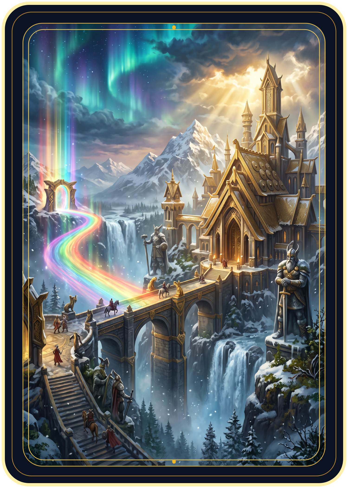
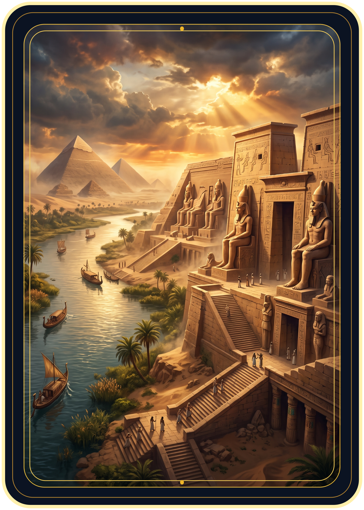
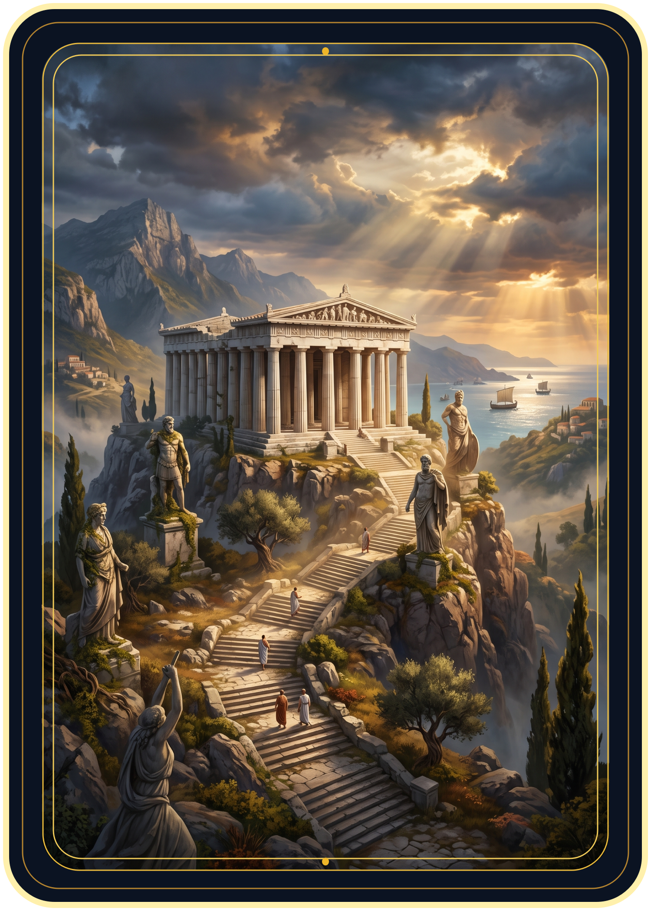

<!doctype html><html lang="pt-BR"><meta charset="utf-8"><meta name="viewport" content="width=device-width,initial-scale=1"><title>Locais — Mythic Clash</title><h1>Cartas de Local</h1>
O Local ativo beneficia os dois jogadores e soma com o Terreno. Um Local por rodada. <a href="index.html">Abrir o jogo</a>
<main><article><h2>Asgard</h2>
Enquanto este Local estiver ativo, todos os nórdicos recebem +2 de poder, nos dois lados do campo.
</article><article><h2>Egito</h2>
Enquanto este Local estiver ativo, todos os egípcios recebem +2 de poder, nos dois lados do campo.
</article><article><h2>Grécia</h2>
Enquanto este Local estiver ativo, todos os gregos recebem +2 de poder, nos dois lados do campo.
</article></main></html>